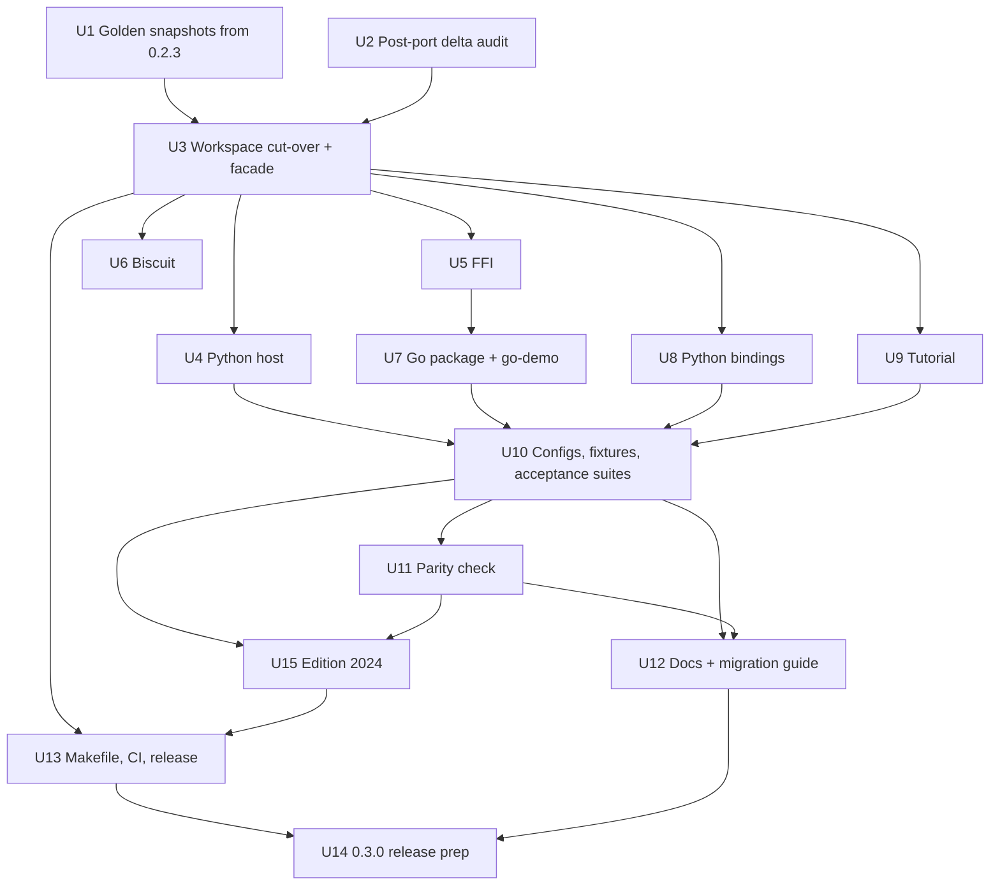

# refactor: Adopt PPE as the CPEX core for 0.3.0

## Summary

Capture 0.2.3 decision snapshots first, while the old engine still exists. Then switch the workspace to PPE 0.4.1 from crates.io in one cut-over and port each kept surface onto it in dependency order: facade, Python host, FFI, biscuit, Python bindings, Go, tutorial. Finish with config and fixture migration, the acceptance and parity suites, docs, Makefile/CI/release machinery, and 0.3.0 release prep.

---

**2026-10-13 release update:** The maintainer selected released PPE 0.5.0 for the final CPEX pin, superseding the original 0.4.x constraint. CPEX adopts its API and documented security changes, reruns parity, and tracks further upstream work in [PPE #208](https://github.com/praxis-proxy/policy/issues/208) and [PPE #209](https://github.com/praxis-proxy/policy/issues/209). Those fixes will be implemented in a separate PPE PR and adopted from a released version.

## Problem Frame

CPEX carries a drifting copy of the engine that now lives in PPE. Every kept CPEX surface is wired to the old crates and the old `PluginManager` name. Full context in the origin document.

---

## Requirements

Carried from the origin document; R-IDs are the origin's.

- R1-R5. crates.io-only PPE 0.4.x dependency; remove replaced crates and pii/audit; keep biscuit, Python host and FFI, ported.
- R6-R8. Clean rename to `PolicyEngine` on every surface; Python `PluginManager` alias is the only shim.
- R9-R11. Bindings ship every non-experimental PPE builtin (adds OPA, CIBA, api-key, Vault), no pii/audit, and outbound-HTTP builtins work without integrator transport code.
- R12-R14. Config follows PPE exactly; all shipped configs ported; key-by-key migration guide.
- R15-R18. CPEX keeps full standalone docs, revised and enriched with current PPE material; reference-plugin registration documented; 0.3.0 changelog lists every break.
- R19-R21. Existing suites pass; new CPEX-side acceptance suite; parity against 0.2.3.
- R22-R24. Makefile, CI and release workflows updated; release as 0.3.0; signed-off short conventional commits without AI trailers.
- R25. Python support keeps working end to end: PyO3 wheel and the `isolated_venv` Python plugin host, with e2e suites green in CI.
- R26. CPEX moves to edition 2024 and resolver 3, matching PPE, as its own change.

**Origin actors:** A1 (Rust embedder), A2 (Python integrator), A3 (Go integrator), A4 (Operator), A5 (Maintainer)
**Origin acceptance examples:** AE1 (covers R6, R7), AE2 (covers R12, R14), AE3 (covers R10, R17), AE4 (covers R11), AE5 (covers R21)

---

## Scope Boundaries

- Carried from origin: no config migration tool or legacy-key acceptance; no Rust or Go aliases; no pii/audit in bindings; no experimental quota in bindings; no PPE feature work beyond upstreaming fixes CPEX needs; no moving or retiring CPEX docs; no Praxis-side changes.
- No new Python API beyond the rename, the alias, the private-destination keyword argument and secret refresh; the Python plugin host stays a Rust facade feature and is not registered by the wheel or FFI, matching 0.2.3.
- No PyPI wheel publish workflow (none exists today; wheels stay Makefile-built).

### Deferred to Follow-Up Work

- Idempotent PPE `install_builtins`: [confirmed defect, PPE #208](https://github.com/praxis-proxy/policy/issues/208). Keep the binding guards; document double install as a Rust host error until the upstream patch ships. Any adopted fix ships in a new PPE release and gates the tag on a new parity run.
- A private-destination allow-list in PPE: [PPE #209](https://github.com/praxis-proxy/policy/issues/209). It is outside this cut-over's feature scope. Meanwhile warn at binding startup when the global opt-in is enabled.
- Distinct `auth.egress_denied` code for identity-jwt in PPE: upstream issue.
- Capture PyO3, Python host venv and HTTP transport learnings with a compound note after 0.3.0 ships.
- Any final deprecation release for removed crate names on crates.io (they stay at 0.2.3; the changelog says so).

---

## Context & Research

### Relevant Code and Patterns

- Facade: `crates/cpex/src/lib.rs` re-exports map 1:1 onto `praxis-policy:crates/ppe/src/lib.rs` (`install_builtins`, `register_builtin_plugins`, `builtin_pdp_factories`, `builtin_session_store_factories`, `register_apl`, `AplOptions`, `SessionStore*`, `PdpFactory`). PPE adds `OpaPdpFactory`, `CibaApproverFactory`, `ApiKeyIdentityFactory`, `VaultSecretProviderFactory`, `registry_with_vault`, `HyperTransport`, `install_default_http_transport`, `prelude`.
- PPE crates have no root re-exports: `PolicyEngine` is at `engine::PolicyEngine`, `PipelineResult` at `executor::PipelineResult`. `bindings/python` imports both from the CPEX crate root today.
- Python host (`crates/cpex-hosts-python/src/factory.rs`): `IsolatedVenvFactory`, `KIND = "isolated_venv"`. Plugin, factory, registry, context, payload, extensions and raw-credential types are public in PPE with the same shapes. Gaps: `CpexConfig` becomes `config::PolicyConfig`, `ManagerConfig` becomes `engine::PolicyEngineConfig`, legacy `hooks::types::hook_names` is gone.
- Hook names changed. CPEX 0.2.3 still accepts the legacy unprefixed names (`tool_pre_invoke`, `tool_post_invoke`, `prompt_pre_fetch`, `prompt_post_fetch`, `resource_pre_fetch`, `resource_post_fetch`, `identity_resolve`, `token_delegate` in `crates/cpex-core/src/hooks/types.rs`). PPE removed them and rejects them at load with a suggestion (`praxis-policy:crates/ppe-core/src/config.rs` tests). Dispatched names are `cmf.*` (with `cmf.prompt_pre_invoke` replacing `prompt_pre_fetch`), `identity.resolve` and `token.delegate`. The Python host's `payload_kind_for_hook` and `is_credential_hook` (`crates/cpex-hosts-python/src/conversion.rs`) match on the legacy names, so a mechanical swap would route identity and delegation hooks to `Generic` and stop passing raw credentials to Python plugins.
- PPE requires plugins that use `jwks_url`, OAuth delegation or CIBA to declare the `perform_http` capability, or the engine refuses to start (`praxis-policy:CHANGELOG.md`). No CPEX config declares it today.
- Egress refusal codes: delegator-oauth reports `delegation.egress_denied` and CIBA `elicitation.egress_denied`. identity-jwt maps a refused JWKS fetch to a recoverable key-source error, so initialization soft-fails and requests report `auth.jwks_unavailable`, the same code an IdP outage produces (`praxis-policy:crates/builtins/src/plugins/identity_jwt/config.rs`).
- PPE reference plugins are `publish = false` and depend on PPE's workspace-path core, so a git dependency would build a second, incompatible `praxis-policy-core`; `deny.toml` also denies unknown git sources.
- Vault in PPE only renews and re-reads secrets when the host calls `PolicyEngine::refresh_secrets()`; `secrets_last_success` reports health.
- PPE `install_builtins` calls `register_apl` each time and `register_visitor` appends, so a second install adds a second APL visitor.
- `.github/workflows/ci.yml` already has a `python-e2e` job running `make test-python-e2e` with skips-as-failures on every non-draft PR. No workflow builds the Python wheel. Go tests are not run in CI today.
- FFI (`crates/cpex-ffi/src/lib.rs`, `crates/cpex-ffi/src/apl.rs`): 18 `extern "C"` functions with a flat `cpex_*` prefix, `FFI_ABI_VERSION = 2`, own tokio `SHARED_RUNTIME`, public `CpexManagerInner { manager }` used by `examples/go-demo/ffi`. `cpex_apl_install` duplicates PPE's `install_builtins` body. No tracked C header; prototypes live in cgo preambles in `go/cpex/ffi.go`, `go/cpex/abi.go`, `go/cpex/apl.go`, `go/cpex/manager.go`.
- Go link flags: `go/cpex/ffi.go` (`-lcpex_ffi`, darwin `-framework CoreFoundation -framework Security`). go-demo pins a real module version.
- Python package: `bindings/python/python/cpex/__init__.py` exports `PipelineResult`, `PluginManager`; stubs in `bindings/python/python/cpex/_lib.pyi`; classes registered via `#[pyclass(name = ...)]` in `bindings/python/src/manager.rs` and `bindings/python/src/result.rs`.
- PPE transport: `install_default_http_transport` is set-once; `HyperTransport` builds without a runtime and blocks private/loopback destinations unless `with_allow_private_destinations()` is used. Builtins needing it: identity-jwt (jwks_url), api-key (http directory), delegator-oauth, elicitation-ciba, Vault. PPE's `install_builtins` does not register Vault; wire it with `set_secret_providers(registry_with_vault(transport))` using the same transport instance.
- PPE wire pinning example: `praxis-policy:crates/ppe-core/tests/wire_compatibility.rs`. Removed-key table: `REPLACED_KEYS` in `praxis-policy:crates/ppe-core/src/config.rs`.
- Stale config keys in kept dirs: `examples/go-demo` (`plugin_settings`, `global.policies`, route `plugins:` lists, `priority:`), `examples/tutorial` (`apl:` wrapper in m05, m18, capstone, capstone-nodeleg; pii/audit in m04 and capstones), `go/cpex/manager_test.go` (`plugin_settings`), `crates/cpex-hosts-python` (top-level `plugin_dirs` in `src/plugin.rs` and `tests/config_e2e.rs`), `bindings/python/tests` fixtures (`priority:`, plus `pii_deny.yaml` and `pii_redact.yaml` using pii/audit). `go/cpex/apl_test.go` and the FFI APL test use `audit/logger`.
- Release machinery: `.github/workflows/release.yaml` (hardcoded publish order, idempotent skip, `cargo package --exclude` dry run), `.github/workflows/ci.yml` (`package` job excludes), `.github/workflows/tutorial.yaml` (path triggers on `crates/**`, `builtins/**`), `.github/workflows/release-ffi.yaml` with `scripts/release/build-artifact.sh` and `scripts/download-ffi-artifact.sh`, `release.toml`, Makefile `examples-run`, `publish-dry`, `tag`, `release*`, `go-*`, `bindings-python-*`, `tutorial-check*`.
- Post-port CPEX deltas touching core or builtins since `aed0f15`: `builtins/pdps/cel/src/resolver.rs`, `builtins/plugins/identity-jwt` tests and manifest, `crates/cpex/src/lib.rs` (python-host feature gate).

### Institutional Learnings

- No `docs/solutions/` in either repo. From history:
  - The 0.2.2 release broke on a missing publish-order entry; the idempotent skip in `release.yaml` must stay.
  - macOS Go static link needed extra frameworks (`b40b22a`); a changed dependency graph can add more.
  - Docs link CI (lychee plus GitHub tree API) fails on links into deleted paths; link updates are part of the work.
  - Renaming an optional dependency silently renames its feature and makes stale `cfg(feature)` predicates false; deny `unexpected_cfgs` (from `docs/plans/2026-08-08-001-feat-praxis-policy-engine-port-plan.md`).
  - Removing a builtin needs feature, dependency, re-export, registration and factory-count assertions removed together (`praxis-policy:docs/dev/port-provenance.md`).
  - Reconcile tests by executed count and list ignored tests explicitly.

---

## Key Technical Decisions

- Parity baseline is golden snapshots captured from 0.2.3, not a side-by-side build: two versions of the same engine in one workspace is fragile, and the first unit runs while the old engine is still present.
- One cut-over commit for all workspace manifests and the facade: the workspace never resolves two engines at once. Cargo must load every member's manifest to resolve the workspace, so the cut-over also repoints every kept crate's `Cargo.toml` to the crates.io PPE crates (kept crates that the facade depends on, such as the Python host and biscuit, use `praxis-policy-core` directly to avoid a cycle). Source ports follow as their own commits; until each lands, only that crate fails to compile, and `cargo build -p cpex` without `python-host` works right after the cut-over. Work happens on one integration branch so `main` never sees the red window.
- PPE is pinned exactly (`=0.5.0`) in the workspace, not by caret. Further engine fixes land in separate PPE PRs and are adopted from released versions. Moving the pin requires rerunning parity (U11).
- Hook names follow PPE. The Python host remaps payload-kind and credential-hook detection onto PPE's dispatched names, the parity fixtures carry an explicit reviewed legacy-to-PPE hook rename table, and the migration guide and changelog list the renames for config authors, Python plugin authors and Go `InvokeByName` callers.
- C ABI symbols rename `cpex_manager_*` to `cpex_engine_*`, the exported inner struct renames to match, and `FFI_ABI_VERSION` goes to 3 so a stale Go build fails its ABI check loudly. Go names follow (`NewPolicyEngine`, `NewPolicyEngineDefault`, `PolicyEngine` type).
- Bindings build one transport per engine with private destinations blocked by default, and a per-binding opt-in (Python constructor keyword argument, Go option, FFI flag) enables `with_allow_private_destinations()`. The switch lives in host code only; no surface reads it from the policy document. The same transport instance is passed to Vault. Tutorial and local demos turn the opt-in on.
- FFI ABI shape for the opt-in: `cpex_apl_install` takes a flags argument with a bit for private destinations. It installs builtins, builds the transport, sets it, and wires Vault with the same instance, and it is idempotent per handle (a second call is a no-op). The one-shot `cpex_engine_new(yaml)` path stays builtin-free and transport-free, as in 0.2.3; hosts that register their own factories install a transport through the same entry point or bring their own.
- Bindings expose secret refresh because they now ship Vault: an FFI refresh entry point returning the refresh report plus a last-success query, Go `RefreshSecrets`, and Python `refresh_secrets`. This is the one deliberate addition to the Python API beyond the rename and alias.
- FFI `cpex_apl_install` delegates to PPE's `install_builtins` instead of reproducing it.
- Workspace denies `unexpected_cfgs` before features are renamed.
- One CPEX wire-compat list pins plugin `kind` strings and hook names. The FFI test asserts it, and the Python bindings test reads the same fixture, so a new PPE builtin is one edit. Other tests only assert pii and audit are absent.
- Acceptance suites live beside each surface's existing tests (Python bindings pytest, Go tests, Python host e2e) rather than in a new top-level harness. The Rust facade is a re-export, so it keeps only its U3 facade test; PPE's own e2e suites cover the engine.
- Post-port deltas are diffed against PPE 0.4.1 first; real fixes go upstream as a 0.4.x patch release, which then gates the 0.3.0 tag.
- Edition 2024 lands as its own unit after the surface ports, not before the cut-over: migrating code first would spend effort on crates U3 deletes, and edition fixes need a compiling crate. Kept crates and examples move together with resolver 3, and the clippy MSRV setting is aligned with PPE's toolchain.
- Python support is a release gate, not a best effort: the existing `python-e2e` CI job stays unfiltered on every non-draft PR and is retargeted to the ported host (including its pinned Python-side checkout and toolchain). New CI work is a wheel build plus smoke test.
- Parity excludes pii and audit flows: 0.3.0 removes those builtins, so their snapshots would only become allow-list entries. The removal is documented as a break instead.
- Implementation must not leak plan or requirement IDs into source, comments or docs.

---

## Open Questions

### Resolved During Planning

- C ABI renames (origin deferred): renamed, ABI version bumped.
- Python host and FFI public-API gaps (origin deferred): `PolicyConfig`, `PolicyEngineConfig` and the hook names differ; the first two exist publicly in PPE 0.4.1, and the hook names change behavior (see Key Technical Decisions).
- Distinct JWT egress code: not required for 0.3.0. `auth.jwks_unavailable` is documented as the symptom of a blocked private JWKS. Adding `auth.egress_denied` upstream is a follow-up.
- Parity mechanism (origin deferred): golden snapshots from 0.2.3.
- Private-destination egress: PPE default with per-binding opt-in (user decision).
- Removed crate names on crates.io (origin deferred): left at 0.2.3, noted in changelog.

### Deferred to Implementation

- Exact representative parity config set: pick during U1 from tutorial modules, go-demo and binding fixtures, covering identity, delegation, each PDP, session labels and elicitation.
- Which PPE e2e flows already cover what the CPEX acceptance suite would test: check `praxis-policy:crates/ppe-core/tests/` when writing U10 and only add CPEX-surface coverage.
- Which PPE doc pages are adopted, adapted or linked: decide per page in U12.
- Whether new native link flags are needed for Go after the transport change: discovered when U7 links on macOS and Linux.
- Whether the CEL resolver delta is already in PPE: determined in U2.
- Whether the out-of-process Python worker SDK (outside this repo, pointed to by `CPEX_PYTHON_SOURCE`) registers handlers by legacy hook names and needs its own release alongside 0.3.0: determined in U4.

---

## High-Level Technical Design

> *This illustrates the intended approach and is directional guidance for review, not implementation specification. The implementing agent should treat it as context, not code to reproduce.*

Unit dependency graph:



Surface layering after the cut-over:

```
praxis-policy (crates.io, exact 0.5.0 pin, features: builtins, http-hyper)
  └─ cpex (facade: re-exports PPE + CPEX-only features)
       ├─ cpex-hosts-python   (isolated_venv factory)
       ├─ delegator-biscuit   (CPEX-owned plugin)
       ├─ cpex-ffi            (C ABI v3, installs builtins + transport + Vault)
       │    └─ go/cpex        (cgo wrapper, PolicyEngine)
       ├─ bindings/python     (PolicyEngine, PluginManager alias)
       └─ examples/tutorial, examples/go-demo
```

---

## Implementation Units

### Phase A: Baseline

- U1. **Capture 0.2.3 golden decision snapshots**

**Goal:** Record what 0.2.3 decides for a representative config and request set, before any crate is removed.

**Requirements:** R21; AE5

**Dependencies:** None

**Files:**
- Create: `tests/parity/` fixtures (configs in 0.2.3 form, request sets, recorded outcomes)
- Create: a small capture harness built against the current workspace; retain its sources and lockfile under `tests/parity/baseline/` when U11 retargets the replay harness. The out-of-tree runner pins the immutable 0.2.3 engine commit.
- Test: `tests/parity/README.md` documents how snapshots were produced and from which commit

**Approach:**
- Pick configs covering identity (jwt, oauth delegation), each PDP (cedar, cel, opa), Valkey session labels, and elicitation. Leave out pii and audit flows, since 0.3.0 removes those builtins.
- Record each request with its hook name and payload, keyed so U11 can map it through the hook rename table. Record per request: allow/deny, violation codes, plugin effects (modified payload, labels, headers). Store in a stable, diffable format.
- Export the raw Valkey `taint:v1` keyspace written during capture into `tests/parity/` so U11 can seed a store from it.
- Exclude anything non-deterministic (timestamps, generated IDs) at capture time, and scrub tokens and keys from recorded effects; fixtures use env or file secret sources, never literals.

**Execution note:** Characterization-first. This unit must land before U3.

**Test scenarios:**
- Happy path: running the harness twice on 0.2.3 produces byte-identical snapshots and keyspace exports.
- Edge case: a config whose request set includes a deny path records the violation code, not only the deny bit.

**Verification:**
- Snapshots exist for every chosen config and are reproducible from the recorded commit.

---

- U2. **Audit post-port CPEX deltas against PPE**

**Goal:** Ensure no CPEX fix made after the port is lost by deleting CPEX's copy.

**Requirements:** R2 (supports), origin key decision on upstreaming

**Dependencies:** None

**Files:**
- Review: `builtins/pdps/cel/src/resolver.rs`, `builtins/plugins/identity-jwt/`, `crates/cpex/src/lib.rs` diffs since `aed0f15`
- Compare: `praxis-policy:crates/builtins/src/pdps/cel/`, `praxis-policy:crates/builtins/src/plugins/identity_jwt/` (or equivalent paths)

**Approach:**
- For each delta, decide: already in PPE, not needed in PPE, or needs upstreaming. Upstream items go to PPE as their own PRs; record any that require a PPE release before the 0.3.0 tag.

**Test expectation:** none -- audit unit; any upstream fix carries its own tests in PPE.

**Verification:**
- Every post-port core/builtin delta has a recorded disposition, and no CPEX-only fix is pending without an upstream PR.

---

### Phase B: Cut-over and surface ports

- U3. **Workspace cut-over and facade re-export**

**Goal:** Replace the CPEX engine crates with PPE 0.4.x and make `cpex` a facade over PPE.

**Requirements:** R1, R2, R3, R6, R8

**Dependencies:** U1, U2

**Files:**
- Modify: `Cargo.toml` (members, default-members, `[workspace.dependencies]`, workspace lints with `unexpected_cfgs` denied)
- Modify: `Cargo.lock`, `deny.toml` (comments naming removed crates)
- Delete: `crates/cpex-core`, `crates/cpex-orchestration`, `crates/cpex-sdk`, `crates/cpex-builtins`, `crates/apl-core`, `crates/apl-cmf`, `crates/apl-cpex`, `builtins/plugins/{pii-scanner,audit-logger,identity-jwt,delegator-oauth,elicitation-ciba}`, `builtins/pdps/{cedar-direct,cel,opa}`, `builtins/session/valkey`
- Modify: `crates/cpex/Cargo.toml`, `crates/cpex/src/lib.rs`, `crates/README.md`
- Modify (manifests only): `crates/cpex-hosts-python/Cargo.toml`, `crates/cpex-ffi/Cargo.toml`, `builtins/plugins/delegator-biscuit/Cargo.toml`, `bindings/python/Cargo.toml`, `examples/tutorial/Cargo.toml`, `examples/go-demo/ffi/Cargo.toml`
- Test: `crates/cpex/src/lib.rs` inline tests, new `crates/cpex/tests/facade.rs`

**Approach:**
- `cpex` depends on `praxis-policy` (exact pin) with `builtins` and `http-hyper`, re-exports its public surface (including `prelude`, `PolicyEngine`, install helpers, factories) and keeps the CPEX-only `python-host` feature.
- Repoint every kept crate's manifest to the crates.io PPE crates in this same commit so the workspace and `Cargo.lock` resolve; source changes stay in U4-U9. Remove `pii`, `audit` and old per-builtin features, or map them to PPE features where the name still means something; drop the ones that no longer do.
- Remove features, deps, re-exports, registration sites and factory-count assertions for removed builtins together.
- Port the facade inline tests to `PolicyConfig` and `cmf.*` hook names.

**Patterns to follow:**
- `praxis-policy:crates/ppe/src/lib.rs` re-export layout.

**Test scenarios:**
- Happy path: `install_builtins` on a new `PolicyEngine` registers no pii or audit kind (the full kind list is asserted once, in U5's wire-compat test).
- Happy path: a config using `cmf.tool_pre_invoke` loads and dispatches through the facade.
- Error path: a config with a stale `cfg(feature)` gate fails the build (verified by the workspace lint, not a runtime test).

**Verification:**
- The workspace resolves; `cargo build -p cpex` and `cargo test -p cpex` without `python-host` pass against crates.io PPE with no path or git dep on PPE; removed directories are gone.
- Record before/after executed-test counts and every ignored test, including doctests, in [test reconciliation](ppe-adoption-test-reconciliation.md). Map every deleted suite to its PPE owner or explicitly document intentional removal. A dependency's tests do not run as part of the CPEX workspace test command.

---

- U4. **Port the Python plugin host**

**Goal:** `isolated_venv` plugins run on `PolicyEngine`.

**Requirements:** R5, R19, R25

**Dependencies:** U3

**Files:**
- Modify: `crates/cpex-hosts-python/Cargo.toml`, `crates/cpex-hosts-python/src/**` (notably `factory.rs`, `plugin.rs`, `testing.rs`)
- Modify: `crates/cpex-hosts-python/README.md`, `crates/cpex-hosts-python/quickstart.md`
- Test: `crates/cpex-hosts-python/tests/{config_e2e,credential_e2e,extensions_merge_e2e,isolated_venv_e2e}.rs`

**Approach:**
- Swap imports to `praxis_policy_core`. Replace `CpexConfig` and `ManagerConfig` with `PolicyConfig` and `PolicyEngineConfig`.
- Remap payload-kind and credential-hook detection onto PPE's dispatched names (`cmf.*`, `identity.resolve`, `token.delegate`), so typed tool, prompt and resource payloads and raw credentials still reach Python plugins.
- Check whether the Python worker SDK registers handlers by legacy names; if it does, coordinate its release with 0.3.0.
- Remove the top-level `plugin_dirs` from fixtures (PPE rejects it); keep the in-plugin `config:` warning logic.

**Test scenarios:**
- Happy path: an `isolated_venv` plugin registered on `PolicyEngine` handles `cmf.tool_pre_invoke` and returns its modified payload.
- Integration: credential and extension-merge e2e tests pass under `CPEX_PYTHON_SOURCE`.
- Error path: a config with top-level `plugin_dirs` fails the load with PPE's unknown-key error.
- Integration: a Python identity plugin on `identity.resolve` and a delegation plugin on `token.delegate` receive the raw credential.
- Edge case: a hook not in the remap table falls back to the generic payload and receives no raw credential.
- Integration: an `isolated_venv` plugin that raises a violation produces the same violation code and deny result through `PolicyEngine` as on 0.2.3 (cross-checked in U11).
- Integration: the `python-host` facade feature registers `isolated_venv` on a `PolicyEngine` built through the facade.

**Verification:**
- Unit tests and the ignored e2e suite pass on the ported crate, and the `python-host` feature builds through the facade.

---

- U5. **Port the C FFI to ABI v3**

**Goal:** The FFI wraps `PolicyEngine`, installs builtins, the transport and Vault, and exposes a private-destination opt-in.

**Requirements:** R5, R6, R9, R10, R11; AE4

**Dependencies:** U3

**Files:**
- Modify: `crates/cpex-ffi/Cargo.toml`, `crates/cpex-ffi/src/lib.rs`, `crates/cpex-ffi/src/apl.rs`
- Test: `crates/cpex-ffi/src/lib.rs` tests, new `crates/cpex-ffi/tests/wire_compat.rs`

**Approach:**
- Rename `cpex_manager_*` to `cpex_engine_*` and the inner struct to match; bump `FFI_ABI_VERSION` to 3.
- `cpex_apl_install` takes a flags argument (bit for private destinations). It calls PPE `install_builtins`, builds one `HyperTransport`, sets it on the engine and passes it to `registry_with_vault`. A per-handle installed flag makes a second call a no-op. The one-shot constructor stays builtin-free and transport-free.
- Add a secret-refresh entry point returning the refresh report and a last-success query.
- Replace the APL test's `audit/logger` usage with a shipped builtin.

**Test scenarios:**
- Happy path: the ABI version call returns 3.
- Covers AE4. Integration: an identity-jwt plugin with `jwks_url` validates a token against a local JWKS server when the private-destination opt-in is on.
- Error path: same config with the opt-in off logs a soft-fail warning at initialize and reports `auth.jwks_unavailable` at request time.
- Error path: an OAuth delegator pointed at a private token endpoint with the opt-in off reports `delegation.egress_denied`.
- Edge case: calling the install entry point twice is a no-op; a later config load yields the same route and plugin counts as a single install.
- Happy path: after a Vault secret is rotated in a test Vault, calling refresh makes the new value visible, and the last-success query reports the refresh time.
- Happy path: the wire-compat test asserts the set of registered `kind` strings and hook names matches the pinned list (no pii/audit, includes opa, ciba, api-key).

**Verification:**
- FFI tests pass; the static and dynamic libs build on the release target matrix.

---

- U6. **Port delegator-biscuit**

**Goal:** Biscuit remains a CPEX-owned plugin on PPE's plugin API.

**Requirements:** R4

**Dependencies:** U3

**Files:**
- Modify: `builtins/plugins/delegator-biscuit/Cargo.toml`, `builtins/plugins/delegator-biscuit/src/**`
- Test: `builtins/plugins/delegator-biscuit/tests/biscuit_e2e.rs`

**Approach:**
- Swap imports to `praxis_policy_core` delegation, plugin and raw-credential modules; tests use `PolicyEngine`. The facade does not expose biscuit, matching 0.2.3.

**Test scenarios:**
- Happy path: a delegate step with biscuit attenuation produces an attenuated token whose caveats match the config.
- Error path: an invalid root key fails plugin initialization with a clear error.

**Verification:**
- Biscuit e2e passes against PPE.

---

- U7. **Port the Go package and go-demo**

**Goal:** Go integrators use `PolicyEngine` over ABI v3, with the private-destination option.

**Requirements:** R6, R8, R9, R11; AE1, AE4

**Dependencies:** U5

**Files:**
- Modify: `go/cpex/{manager,apl,cmf,identity,ffi,abi,types,constants,errors}.go` (rename `manager.go` if it helps readability), `go/cpex/README.md`
- Modify: `examples/go-demo/**` (ffi crate, `go.mod` pin to 0.3.0, YAML configs)
- Test: `go/cpex/{manager_test,apl_test,cmf_test}.go`

**Approach:**
- Rename Go API (`NewPolicyEngine`, `NewPolicyEngineDefault`, `PolicyEngine`), update cgo prototypes to `cpex_engine_*`, check ABI v3 at init, add an option for private destinations that maps to the install flags, and add `RefreshSecrets` plus a last-success query.
- Go tests are not in CI today; U13 adds them.
- Re-verify link flags on macOS and Linux; add frameworks or libs if the new dependency graph needs them.
- go-demo ffi uses the renamed inner struct; its configs are ported in U10.

**Test scenarios:**
- Happy path: create engine, load config, invoke `cmf.tool_pre_invoke`, shut down.
- Error path: a library built at ABI v2 is rejected with an ABI mismatch error.
- Integration: `go test -race` passes against the static library on macOS and Linux.

**Verification:**
- Go tests and race tests pass; go-demo builds and runs.

---

- U8. **Port the Python bindings**

**Goal:** The wheel exposes `PolicyEngine`, keeps the `PluginManager` alias, and ships the new builtin set with the transport opt-in.

**Requirements:** R6, R7, R9, R10, R11, R25; AE1, AE3

**Dependencies:** U3

**Files:**
- Modify: `bindings/python/Cargo.toml`, `bindings/python/src/{lib,manager,result,builtins}.rs`
- Modify: `bindings/python/python/cpex/__init__.py`, `bindings/python/python/cpex/_lib.pyi`, `bindings/python/pyproject.toml` (version)
- Test: `bindings/python/tests/*.py`, fixtures under `bindings/python/tests/`

**Approach:**
- Import `engine::PolicyEngine` and `executor::PipelineResult` from their modules. Rename the pyclass to `PolicyEngine`; `__init__.py` adds `PluginManager = PolicyEngine`; stubs and `__all__` list both.
- Builtin registration delegates to PPE `install_builtins`, plus the shared transport and Vault, matching the FFI, and is idempotent. Add `refresh_secrets` and a last-success accessor. Add a constructor keyword argument for private destinations; no surface reads this switch from the policy document.

**Test scenarios:**
- Covers AE1. Happy path: `from cpex import PluginManager` and `from cpex import PolicyEngine` refer to the same class; both load and run a migrated config.
- Covers AE3. Error path: a config declaring `validator/pii-scan` fails with an unknown-kind error.
- Happy path: OPA and CIBA kinds load in a config (CIBA with a mocked endpoint and the opt-in on).
- Integration: a freshly built wheel installs into a clean venv, imports `cpex`, and runs a policy (smoke test used by CI).
- Happy path: the registered kind and hook names match the shared wire-compat fixture.
- Error path: invoking a hook from Python after `shutdown` raises a Python exception rather than crashing the interpreter.

**Verification:**
- Binding tests pass via the Makefile binding targets; stubs type-check; the wheel smoke test passes.

---

- U9. **Port the tutorial**

**Goal:** The tutorial builds and passes its checks on PPE.

**Requirements:** R6, R13, R19

**Dependencies:** U3

**Files:**
- Modify: `examples/tutorial/Cargo.toml`, `examples/tutorial/src/**`, `examples/tutorial/tests/policy_tests.rs`, `examples/tutorial/README.md`

**Approach:**
- Replace the old SDK crate imports with `prelude`, `PluginManager` with `PolicyEngine`. The tutorial's HTTP transport turns on private destinations (JWKS on localhost), with a comment that this is not a production setting. Module YAML is ported in U10.

**Test scenarios:**
- Integration: the local tutorial check passes; the Keycloak and SPIRE variants pass in CI.

**Verification:**
- `examples/tutorial` builds; policy tests pass.

---

### Phase C: Configs, verification and docs

- U10. **Migrate configs and fixtures; add acceptance suites**

**Goal:** Every shipped config loads under PPE, and each CPEX surface has acceptance coverage for key flows.

**Requirements:** R12, R13, R19, R20; AE2, AE3

**Dependencies:** U4, U7, U8, U9

**Files:**
- Modify: `examples/go-demo/*.yaml`, `examples/tutorial/policies/**`, tutorial module YAML (m04, m05, m18, capstone, capstone-nodeleg), `go/cpex/manager_test.go` fixtures, `bindings/python/tests/` fixtures (including `pii_deny.yaml`, `pii_redact.yaml`), `crates/cpex-hosts-python` fixtures
- Create: `bindings/python/tests/test_acceptance.py`, `go/cpex/acceptance_test.go`, `crates/cpex-hosts-python/tests/acceptance_e2e.rs`

**Approach:**
- Rewrite stale keys (`plugin_settings`, `global.policies`, route `plugins:` lists, `priority:` outside hooks mode, `apl:` wrapper, top-level `plugin_dirs`) and legacy hook names to PPE shape; declare `perform_http` on every plugin using `jwks_url`, OAuth delegation or CIBA; resolve unreached-plugin load failures.
- pii/audit fixtures in Python and Go switch to shipped builtins. Tutorial modules using pii/audit (m04 and the capstones) switch to shipped builtins; the docs, not the tutorial, show Rust-host registration of the reference plugins.
- Acceptance flows per surface: config load (including a removed-key failure), identity, delegation, each PDP decision, session labels, elicitation where practical. Skip flows already proven by PPE's own e2e suites unless the CPEX surface adds risk.
- Record each config rewrite pattern for the migration guide (U12).

**Test scenarios:**
- Covers AE2. Error path: a 0.2.x config with `global.policies:` fails with an unknown-key error naming the key, through Python, Go and Rust.
- Happy path: each migrated example config loads with no unreached-plugin error.
- Integration: Python and Go acceptance suites drive identity, a cedar decision and an opa decision end to end through the native library.
- Integration: the Python host acceptance test runs an `isolated_venv` plugin in the identity and PDP flows through `PolicyEngine`.
- Error path: a config using `jwks_url` without `perform_http` fails to start with PPE's capability error.
- Integration: session labels persist across two engines sharing a Valkey store (ignored test, run in CI with a service container).

**Verification:**
- All shipped configs load; acceptance suites pass on the Python bindings, Go/FFI and Python host surfaces.

---

- U11. **Parity check against 0.2.3 snapshots**

**Goal:** Prove 0.3.0 decisions match 0.2.3, or document every difference.

**Requirements:** R21; AE5

**Dependencies:** U1, U10

**Files:**
- Modify: `tests/parity/` (add migrated configs alongside 0.2.3 forms, and the reviewed legacy-to-PPE hook rename table)
- Create: a parity test that replays request sets through the 0.3.0 facade and diffs against the U1 snapshots (location chosen during implementation)

**Approach:**
- Requests replay through the hook rename table, and a store seeded from the U1 Valkey export is loaded before session-label replays.
- Assert exactly one row for every captured hook name and assert PPE target coverage against its builtin registry, with any unused names listed explicitly. Check skipped fixtures too; reject duplicate keys and incorrect removed-hook replacements.
- Each difference is either fixed (CPEX port bug or upstream PPE fix) or listed as intended with its cause, feeding the migration guide.

**Test scenarios:**
- Covers AE5. Happy path: for each config, decisions and violation codes match the snapshot.
- Integration: session labels written by 0.2.3 (from the keyspace export) are read back unchanged by 0.3.0.
- Edge case: a known intended difference (for example a load-time failure PPE adds) is asserted against an allow-list entry, so it cannot drift silently.

**Verification:**
- Parity test passes with an explicit, reviewed list of intended differences.

---

- U12. **Docs, migration guide and changelog content**

**Goal:** CPEX docs reflect 0.3.0 and include current PPE material.

**Requirements:** R14, R15, R16, R17, R18

**Dependencies:** U10, U11

**Files:**
- Modify: `README.md`, `docs/content/_index.md`, `docs/content/docs/*.md` (overview, quickstart, configuration, pipeline, builtins, extensions, identity-delegation, patterns, deployment, testing, threat-model, reference), `docs/content/docs/apl/**`, `docs/content/docs/tutorial/**`, `docs/specs/**`, `docs/operations/valkey-session-store.md`, `go/cpex/README.md`, `crates/README.md`
- Create: `docs/content/docs/migration-0.3.md`, and new pages adapted from PPE (HTTP routing, assertions, auditing, identity claim mapping, CMF extensions, crate map)

**Approach:**
- Rename across docs; update every config snippet to PPE shape; document new builtins in bindings.
- Document HTTP transport and the private-destination opt-in per binding. State that the switch also permits loopback, RFC 1918, link-local (including cloud metadata) and CGNAT for every outbound builtin, and that tutorial and demo settings are not for production.
- Document Rust-host registration of PPE's reference plugins by copying their source into the embedder's own workspace, built against crates.io `praxis-policy-core`, and state they are absent from bindings.
- Document that binding hosts using Vault must call secret refresh on an interval and alarm on the last-success value.
- Update the threat-model page for the new binding builtins (Vault auth and secret handling, CIBA, api-key directory, OPA), the bundled transport and its private-destination default, and the secret-refresh responsibility of binding hosts.
- Migration guide sections: API renames (Rust, Python, Go, C ABI), hook renames (for config, Python plugin authors and Go `InvokeByName` callers), config keys (from U10 notes and `REPLACED_KEYS`), new required capabilities (`perform_http`), dispatch default and load-time failures, egress default (including that a blocked private JWKS shows as `auth.jwks_unavailable`), builtins added/removed, intended parity differences (from U11).
- Fix links into deleted paths and renamed Praxis paths; keep `0.1.x` docs as legacy.

**Test scenarios:**
- Test expectation: none -- docs; correctness is enforced by the docs build and link check in CI.

**Verification:**
- Docs site builds; link check passes; no `PluginManager` reference outside the Python alias note and the migration guide.

---

### Phase D: Build, CI and release

- U13. **Makefile, CI and release workflows**

**Goal:** Build, test and release machinery match the new layout.

**Requirements:** R22, R19, R25

**Dependencies:** U3 (can progress alongside U4-U12; finalize after U15)

**Files:**
- Modify: `Makefile` (`examples-run`, `publish-dry`, `tag`, `release*`, `go-*`, `bindings-python-*`, `tutorial-check*`, new acceptance and parity targets)
- Modify: `.github/workflows/ci.yml`, `.github/workflows/release.yaml`, `.github/workflows/release-ffi.yaml`, `.github/workflows/tutorial.yaml`, `.github/workflows/coverage.yaml`, `.github/workflows/supply-chain.yaml`, `.github/workflows/docs-build.yaml` if paths change
- Modify: `release.toml`, `scripts/release/build-artifact.sh`, `scripts/download-ffi-artifact.sh` if names change

**Approach:**
- Rewrite the publish order to the kept publishable crates in dependency order (python host, biscuit, facade, cpex-python, any other kept publishable crate); keep the idempotent skip; update `cargo package --exclude` lists.
- Remove `examples-run` targets that ran removed crates' examples; repoint to facade examples or drop.
- Wire acceptance and parity into CI; run the Go race job on macOS and Linux.
- Keep the existing `python-e2e` job unfiltered and retarget it to the ported host (pinned Python-side checkout, toolchain). Add a wheel build plus smoke test job.
- Add Go test and race jobs (not in CI today) on macOS and Linux.
- Review `deny.toml` and supply-chain checks for the new transport and TLS dependencies pulled in by `http-hyper`.
- Update tutorial path triggers to the kept directories.

**Test scenarios:**
- Test expectation: none -- build configuration; verified by a green CI run and a release dry run.

**Verification:**
- Full CI passes on a PR branch; release dry run packages every publishable crate in order.

---

- U14. **0.3.0 release prep**

**Goal:** Version, changelog and tags ready for 0.3.0.

**Requirements:** R18, R23, R24

**Dependencies:** U12, U13, and any PPE release gated by U2

**Files:**
- Modify: `CHANGELOG.md`, workspace version, `bindings/python/pyproject.toml`, `examples/go-demo/go.mod`, `ADOPTERS.md`/`README.md` version mentions if any

**Approach:**
- Changelog lists every break across Rust, Python, Go, C ABI and config, links the migration guide, and notes removed crates stay at 0.2.3 on crates.io.

**Test scenarios:**
- Test expectation: none -- release metadata.

**Verification:**
- Release dry run succeeds; all commits on the branch are signed off with short conventional messages and no AI trailers.

---

- U15. **Move CPEX to edition 2024**

**Goal:** CPEX uses the same edition and resolver as PPE.

**Requirements:** R26

**Dependencies:** U4, U5, U6, U7, U8, U9, U10, U11

**Files:**
- Modify: `Cargo.toml` (workspace `edition`, `resolver = "3"`), every kept crate's `Cargo.toml`, `clippy.toml`, `rustfmt.toml` (style edition), `rust-toolchain.toml` if PPE's pin moves
- Modify: source in `crates/cpex`, `crates/cpex-hosts-python`, `crates/cpex-ffi`, `builtins/plugins/delegator-biscuit`, `bindings/python`, `examples/go-demo/ffi`, `examples/tutorial` as the edition migration requires

**Approach:**
- Mechanical edition migration on the already-ported crates, then manual review of the semantic changes edition 2024 brings: `unsafe extern` blocks and `unsafe` attributes such as `no_mangle` (heavy in the FFI), `unsafe_op_in_unsafe_fn`, `gen` keyword, RPIT lifetime capture, tail-expression temporary scope, `if let` rescoping, and `std::env::set_var` becoming unsafe in tests.
- Land as its own commit series, separate from behavior changes, so review can confirm no semantic drift.

**Patterns to follow:**
- PPE's own edition move and lint settings: `praxis-policy:Cargo.toml`, `praxis-policy:clippy.toml`, `praxis-policy:docs/dev/lints.md`.

**Test scenarios:**
- Test expectation: none new -- behavior-neutral; the full existing suite plus acceptance and parity (U10, U11) must stay green before and after.

**Verification:**
- Workspace builds on edition 2024 with resolver 3; clippy and fmt clean; FFI, Go, Python and parity suites unchanged in results.

---

## System-Wide Impact

- **Interaction graph:** Every host entry point changes: Rust facade, FFI and Go, PyO3, Python host. The Go package depends on the exact C ABI; the go-demo depends on the FFI's public inner struct.
- **Error propagation:** Egress refusal surfaces as `egress_denied` for oauth and CIBA, and as `auth.jwks_unavailable` for JWT; config errors (stale keys, legacy hook names, missing `perform_http`) surface at load, not at request time.
- **State lifecycle risks:** The transport is set-once per engine; double install must stay a no-op. Valkey session store keys and format come from PPE; the parity check should confirm 0.2.3 stored labels are still readable.
- **API surface parity:** Rename and builtin set must match across Rust, Python, Go and the C ABI; the wire-compat test guards kinds and hook names.
- **Integration coverage:** Python wheel smoke test and `isolated_venv` e2e as CI gates; Go race and static link on macOS and Linux; Python e2e host; Keycloak and SPIRE tutorial variants.
- **Unchanged invariants:** Plugin `kind` strings, APL syntax and violation codes stayed wire-compatible. Hook names did not: legacy unprefixed names are removed, `prompt_*_fetch` became `cmf.prompt_*_invoke`, and identity and delegation use `identity.resolve` and `token.delegate`.

---

## Risks & Dependencies

| Risk | Mitigation |
|------|------------|
| PPE lacks something a kept crate needs | Fixable gaps become separately reviewed PPE releases, gating the 0.3.0 tag; unfixable or unexplained gaps trigger the abort criterion below |
| A needed PPE fix ships alongside unrelated breaking changes | Review the release changes and port affected surfaces; rerun U11 whenever the exact pin moves |
| Python plugins silently lose credentials after the hook rename | Remap in U4 with tests that raw credentials arrive on `identity.resolve` and `token.delegate` |
| The external Python worker SDK dispatches only legacy hooks | The in-repo legacy payload shim preserves 0.1.x workers; gate merge and the 0.3.0 tag on the four `make test-python-e2e` suites (credential, isolated-venv, extensions-merge and acceptance) against the supported `CPEX_PYTHON_SOURCE` checkout with no skips. If that compatibility path fails and requires an SDK change, the CPEX release maintainer coordinates and verifies the SDK release before tagging 0.3.0 |
| Session store format drift breaks existing Valkey data | Include a stored-label read in parity snapshots; document if incompatible |
| New native link deps break Go builds on one platform | Run Go race on macOS and Linux in CI from U7 onward |
| Egress default breaks integrators silently | Distinct codes for oauth and CIBA; JWT shows `auth.jwks_unavailable`, called out in the migration guide; opt-in documented per binding |
| Vault secrets go stale in bindings | Refresh entry point on every surface; docs require periodic refresh |
| Stale `cfg(feature)` predicates drop exports silently | Deny `unexpected_cfgs` in U3 |
| Publish order wrong for the new crate set | Release dry run in CI; idempotent skip allows a rerun |
| Docs link CI fails on deleted paths | Link fixes are part of U12, not cleanup |
| Edition 2024 changes FFI `unsafe` semantics or drop order | Separate commit series after ports; parity and FFI suites rerun before and after |
| Python wheel breaks without notice (no wheel CI today) | Wheel build and smoke test job (U13) |

**Abort criterion:** If U11 finds a behavior difference that cannot be fixed or explicitly accepted with its cause and migration impact by the CPEX release maintainer, stop the cut-over and leave the integration branch unmerged and 0.3.0 untagged; the release maintainer decides whether to resume after a fix or abandon the branch.

---

## Documentation / Operational Notes

- Migration guide is the primary upgrade path for adopters; announce it with the release.
- Go consumers must update both the module and the FFI artifact together (ABI v3).

---

## Sources & References

- **Origin document:** [docs/brainstorms/ppe-core-adoption-requirements.md](../brainstorms/ppe-core-adoption-requirements.md)
- Prior plan: [docs/plans/2026-08-08-001-feat-praxis-policy-engine-port-plan.md](2026-08-08-001-feat-praxis-policy-engine-port-plan.md)
- PPE: `praxis-policy:CHANGELOG.md`, `praxis-policy:docs/dev/port-provenance.md`, `praxis-policy:docs/content/upgrade-apl.md`, `praxis-policy:crates/ppe/src/lib.rs`
